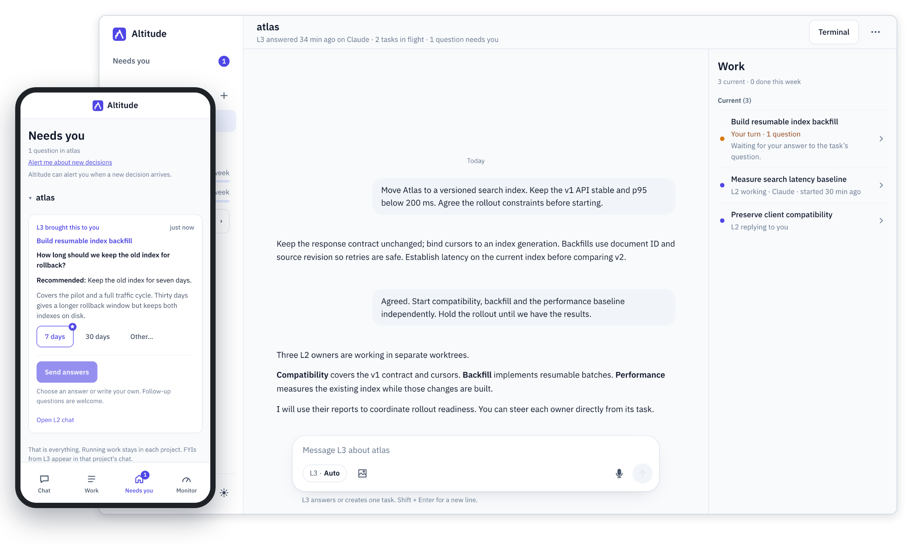

#  Altitude

## Be the lead, not the bottleneck.

Altitude runs Claude Code and Codex like an engineering team on your computer.

- **You make the executive decisions; Altitude handles the rest.** Only the calls that need you
  reach you, wherever you are.
- **A coordinator runs your project with you** and answers the agents from what you have decided.
- **Every task gets its own agent,** from idea to production, around the clock.
- **It heals and improves itself.** When something breaks, the coordinator fixes it and the work
  resumes, and every fix makes it better.

**Early preview · Linux · macOS · [Get started](#get-started)**



## Work at any altitude

<picture>
  <source media="(max-width: 600px)" srcset="docs/images/altitude-phone.svg">
  
</picture>

Altitude works in levels, and you choose yours: steer the whole project with the coordinator, or step
straight into any task. Each task agent works in its own worktree, and complex work gets an independent review,
by your other engine when you use both.

One engine is enough, and each integration is
[replaceable by design](docs/ARCHITECTURE.md#engine-integration-boundary).

[Explore the desktop and phone walkthrough](docs/WALKTHROUGH.md)

## Built in

- **Your checks, your call.** Your project's checks and review govern every merge; ask for a merge
  hold whenever you want the final say.
- **Phone access.** [Pair each browser](docs/SETUP.md#pair-each-device) with a one-time code, add
  Altitude to the iPhone Home Screen and get an alert when a decision needs you, choosing on each
  device how much the alert reveals, how often it comes and whether it sounds. Dictation runs on
  your computer on Linux and on Macs with Apple silicon, and uses the browser's recognition elsewhere.
- **Terminals beside the work.** [Open a shell](docs/ARCHITECTURE.md#operator-terminal) in a task's
  worktree or the project folder from the browser. A command an agent hands you arrives typed at
  the prompt, waiting for your Enter.
- **Operator grants.** When a task needs to act on your machine beyond its sandbox, such as a
  service change or a release, you [approve one stated purpose](docs/CLI.md#operator-grant); each
  command runs as you and is recorded on the task.
- **Validation runs.** Owners check their changes in
  [disposable runs](docs/DEVELOPMENT.md#validation-runner) before merging: a Linux container, a
  confined run on a Mac or an iOS Simulator iPhone.

## Get started

Altitude runs for one person on Linux with a systemd user manager or on macOS 15 or newer; releases
are validated on Ubuntu 24.04 x86_64 and Apple silicon Macs. You need Python 3.12+, Git, OpenSSL (on
a Mac, Homebrew's `openssl@3`), an authenticated GitHub CLI 2.72 or newer ([setup](docs/SETUP.md))
and one authenticated coding CLI. Agent work uses your coding account's allowance and normal charges.
A [Linux container deployment](docs/CONTAINERS.md) is under validation.

1. Install the latest release as the account that will use Altitude:

   ```sh
   curl --proto '=https' --tlsv1.2 -fsSL https://github.com/mburakyucel/altitude/releases/latest/download/install.sh | sh
   ```

   Releases are early previews: expect rough edges, and read the
   [release notes](CHANGELOG.md) for known limitations. The script checks the machine, runs
   nothing it downloads unless it matches the release's checksums and prints the next steps. The
   [installation steps](docs/SETUP.md#install-the-application) explain what it trusts and how to
   verify a release's script before running it.
2. Put `~/.local/bin` on your PATH and run `alt doctor`. The release includes the CLI, daemon and
   web app; installation enables a per-user service and saves its tool PATH.
3. Follow the [certificate trust guide for Linux, macOS and phones](docs/SETUP.md#trust-https-on-each-device).
   On the hosting computer, use the public CA file reported by `alt doctor`. To
   [pair another device](docs/SETUP.md#pair-each-device), run `alt pair` on the hosting computer
   and open its printed address or scan its QR code. **Pair this device** guides certificate
   trust before you enter the code: compare the certificate with the computer, trust it
   deliberately and verify the exact HTTPS URL without a warning. **Set up a device** and
   `alt tls-share` also offer certificate setup. Use
   [First run](docs/SETUP.md#first-run-in-the-browser) to add your project.

<details>
<summary>Ask your coding agent to help install</summary>

Paste into Claude Code or Codex on the machine that will run Altitude. This is assisted setup;
unattended installation is not yet validated.

```text
Help me install Altitude using https://github.com/mburakyucel/altitude/blob/main/docs/SETUP.md
and the instructions shipped with the selected version. Check prerequisites and my normal
engine/tool PATH first. Install only from the project's published GitHub release, as that guide
describes, and stop if a download or checksum check fails. Ask before privileged commands or changes
to existing configuration, services or shell profiles. Keep localhost HTTPS and security and
authority safeguards. Leave authentication and certificate trust to me in my own terminal or
browser; never read or copy credentials or private keys. Stop and explain refused or failed
checks. Run alt doctor and report anything unverified. Do not discover repositories, register
projects or start tasks; I will choose my project in the app.
```

</details>

## Documentation

| Start here | Go deeper |
| --- | --- |
| [Setup](docs/SETUP.md) · [Run from source](docs/SETUP.md#run-from-a-source-checkout) | [Architecture](docs/ARCHITECTURE.md) · [Session lifecycle](docs/SESSION_LIFECYCLE.md) |
| [Walkthrough](docs/WALKTHROUGH.md) | [CLI reference](docs/CLI.md) · [Operations](docs/OPERATIONS.md) |
| [Contributing](CONTRIBUTING.md) | [Development and checks](docs/DEVELOPMENT.md) |
| [Roadmap](docs/ROADMAP.md) | [Release checkpoints](docs/RELEASING.md) · [Changelog](CHANGELOG.md) |

## Feedback

[Open an issue](https://github.com/mburakyucel/altitude/issues/new/choose) with a bug, idea or
confusing part of setup. Keep examples fictional or redacted. Report vulnerabilities privately
using the [security policy](SECURITY.md).

Altitude is source-available under the [Functional Source License](LICENSE).
