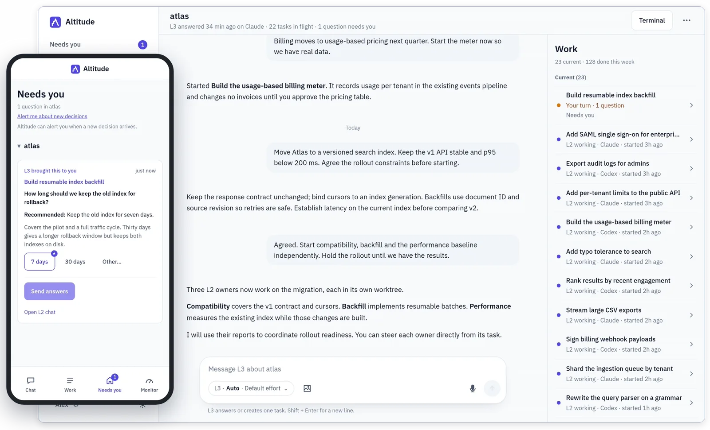
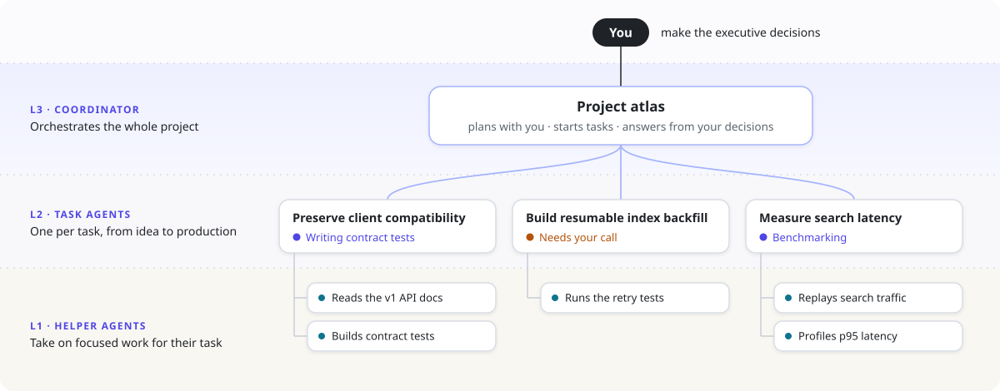
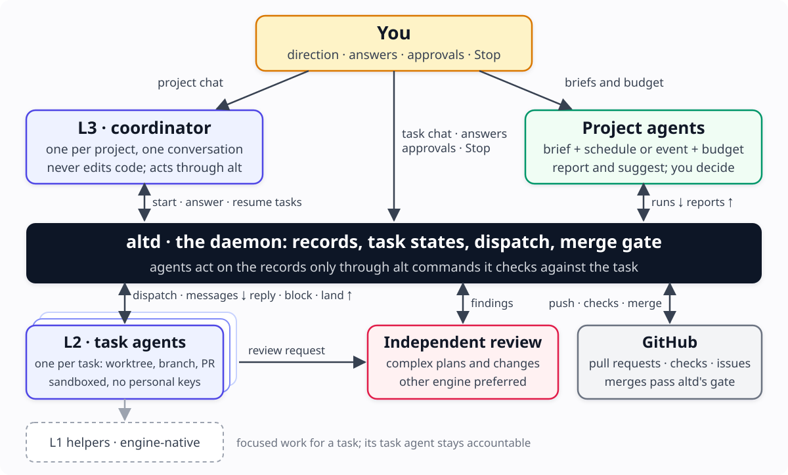

#  Altitude

[](https://github.com/mburakyucel/altitude/actions/workflows/hosted-checks.yml?query=branch%3Amain+event%3Apush)
[](https://github.com/mburakyucel/altitude/releases)
[](LICENSE)

## Be the lead, not the bottleneck.

Altitude runs Claude Code and Codex like an engineering team on your computer.

- **You make the executive decisions; Altitude handles the rest.** Only the calls that need you
  reach you, wherever you are.
- **A coordinator runs your project with you** and answers the agents from what you have decided.
- **Every task gets its own agent,** from idea to production, around the clock.
- **It heals and improves itself,** so the work keeps moving and keeps getting better.

**Linux · macOS · [Get started](#get-started)**



## Work at any altitude



Altitude works in levels, and you choose yours: steer the whole project with the coordinator, or step
straight into any task.

One engine is enough, and each integration is
[replaceable by design](docs/ARCHITECTURE.md#engine-integration-boundary).

## What you get

- **Self-healing.** When something breaks, it gets repaired and the work picks up where it stopped.
- **Self-improving.** Altitude learns from its own finished work and fixes what slowed it down.
- **Routines that keep watch.** Give a project standing briefs that run on a schedule or when your own scripts
  send an event, like a look at each merge. A routine works on a throwaway copy, tells you what it found and
  suggests the tasks worth doing; one tap makes one a task. Allow one to, and it clears worktrees and branches
  nothing needs, each with Undo. A dependency check, a build health check, a weekly summary of what landed and a
  weekly tidy-up come built in.
- **Parallel without collisions.** Many tasks at once, each on its own copy of the code.
- **Balanced quotas.** By default, each task goes to the engine that has used less of its week, so both are
  used evenly.
- **Steer mid-flight.** Watch any agent live, redirect it in a sentence or take the terminal. When a step
  needs you, like a password or a deploy only you may run, the command waits typed in a terminal; press Enter
  and the agent reads the result and carries on.
- **Nothing ships unchecked.** Your checks gate every merge, complex work gets an independent review,
  and the final say is yours whenever you want it.
- **Decide from anywhere.** Everything that waits on you gathers in Needs you, and your phone alerts you;
  answer with a tap or your voice. Dictate with built-in recognition, your browser, or
  [your own speech service](docs/SETUP.md#your-speech-service).
- **Agent chats.** Talk something through with a coding agent in its own copy of the code, from your phone or
  computer, without making it a task; each chat picks up where you left off.
- **Power with a fence.** Agents leave their sandbox only for a purpose you approve, and the sandbox hides the
  sign-ins and keys your other programs keep.



[See it all in the desktop and phone walkthrough](docs/WALKTHROUGH.md#see-the-features)

## How it works

Under the hood, one daemon on your computer, altd, holds the record of every project and task. The state of
the work lives there, not in any model's memory, so a session that stops picks up where the record left off.



## Get started

Altitude runs for one person on Linux 6.5 or newer with a systemd user manager or on macOS 15 or newer; releases
are validated on Ubuntu 24.04 x86_64 and Apple silicon Macs. You need Python 3.12+, Git, OpenSSL (on
a Mac, Homebrew's `openssl@3`), an authenticated GitHub CLI 2.72 or newer ([setup](docs/SETUP.md))
and one authenticated coding CLI. Agent work uses your coding account's allowance and normal charges.

1. Install the latest release as the account that will use Altitude:

   ```sh
   curl --proto '=https' --tlsv1.2 -fsSL https://github.com/mburakyucel/altitude/releases/latest/download/install.sh | sh
   ```

   The script checks the machine, runs nothing it downloads unless it matches the release's
   checksums and prints the next steps. The [installation steps](docs/SETUP.md#install-the-application)
   explain what it trusts and how to verify a release's script before running it, and the
   [release notes](CHANGELOG.md) list what each version brings.
2. Trust Altitude's certificate with the
   [certificate guide for Linux, macOS and phones](docs/SETUP.md#trust-https-on-each-device),
   comparing its name and full SHA-256 with the installer's output. Then open the private link the
   installer prints. It pairs this browser and opens [First run](docs/SETUP.md#first-run-in-the-browser),
   which checks your coding tools and adds your first project. A project added before a coding tool is
   ready waits and starts by itself once one is. Over SSH, the installer prints the `ssh -L` tunnel to
   open the link from your own computer. The link works once, for ten minutes; if it expires, run
   `~/.local/bin/alt pair` on the computer running Altitude.
3. For terminal use, put `~/.local/bin` on your PATH. `alt doctor` shows where Altitude runs, its
   address and the next thing to set up. [Pair additional devices](docs/SETUP.md#pair-each-device) with
   `alt pair` or Settings → Devices.

`alt uninstall` removes the service and the `alt` command and keeps your settings, certificates, paired
browsers and data; [setup](docs/SETUP.md#install-the-application) has the details.

Altitude runs as a per-user background service on the computer you installed it on; closing the
terminal or the browser leaves it running. The default `https://127.0.0.1:8890` opens only on that
computer. **Settings → Network** explains reaching it from a phone or another computer, and how an
optional private VPN fits in. The installer opens no browser and changes no certificate trust.

<details>
<summary>Ask your coding agent to help install</summary>

Paste into Claude Code or Codex on the machine that will run Altitude.

```text
Help me install Altitude using https://github.com/mburakyucel/altitude/blob/main/docs/SETUP.md
and the instructions shipped with the selected version. Check prerequisites and my normal
engine/tool PATH first. Install only from the project's published GitHub release, as that guide
describes, and stop if a download or checksum check fails. Ask before privileged commands or changes
to existing configuration, services or shell profiles. Keep localhost HTTPS and security and
authority safeguards. Leave authentication and certificate trust to me in my own terminal or
browser; never read or copy credentials or private keys. Stop and explain refused or failed
checks. Run alt doctor and report anything unverified. Do not discover repositories, register
projects or start tasks; I will choose my project in the app.
```

</details>

## Documentation

| Start here | Go deeper |
| --- | --- |
| [Setup](docs/SETUP.md) · [Run from source](docs/OPERATIONS.md#run-from-a-source-checkout) | [Overview](docs/OVERVIEW.md) · [Architecture](docs/ARCHITECTURE.md) · [Session lifecycle](docs/SESSION_LIFECYCLE.md) |
| [Walkthrough](docs/WALKTHROUGH.md) | [CLI reference](docs/CLI.md) · [Operations](docs/OPERATIONS.md) |
| [Contributing](CONTRIBUTING.md) | [Development and checks](docs/DEVELOPMENT.md) |
| [Roadmap](docs/ROADMAP.md) | [Release checkpoints](docs/RELEASING.md) · [Changelog](CHANGELOG.md) |

## Feedback

[Open an issue](https://github.com/mburakyucel/altitude/issues/new/choose) with a bug, idea or
confusing part of setup. Keep examples fictional or redacted. Report vulnerabilities privately
using the [security policy](SECURITY.md).

Altitude is source-available under the [Functional Source License](LICENSE).
